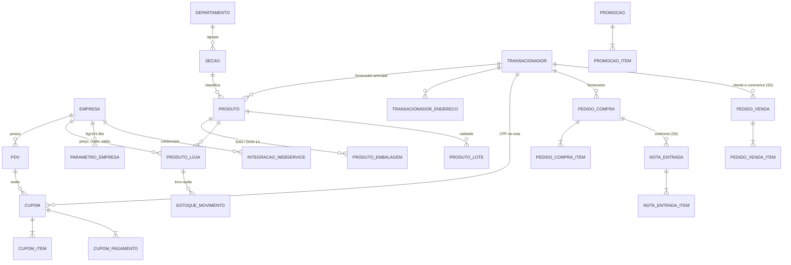

# S1 · Mini-ERP de supermercado em PostgreSQL

Modelo de dados de uma **rede de supermercados** (1 CD + 5 lojas no oeste catarinense) com 90 dias de operação simulada: cadastro mercadológico, transacionadores, PDV/NFC-e, livro-razão de estoque com **custo médio móvel**, quebras, lotes com validade, promoções, pedidos de compra e pedidos de e-commerce.

É o "ERP de laboratório" dos outros projetos deste repositório: o integrador **S2** grava pedidos aqui, o **S3** gera carga de balança a partir dos pesáveis, o **S4** lê ruptura/margem/validade e o **S5** confronta pedidos de compra com o XML da nota.

> Modelo didático inspirado no vocabulário público do varejo alimentar e do Sysmo S1 (transacionador, empresa/CD, embalagem, código de balança, parâmetros por empresa). **Não é** o banco do Sysmo S1 e não tem afiliação com a Sysmo Sistemas. Todos os dados são sintéticos; as marcas são fictícias.

## O que tem na base (escala 1)

| | |
|---|---|
| Empresas | 1 CD + 5 lojas, 62 PDVs (caixas e self-checkout) |
| Produtos | ≈13 mil SKUs em 10 departamentos e 21 seções, 127 pesáveis com PLU de balança |
| Embalagens | EAN-13 de unidade e DUN-14 de caixa, todos com dígito verificador válido |
| Transacionadores | 50 mil clientes (CPF válido, sintético) + 150 fornecedores (CNPJ válido) |
| PDV | ≈214 mil cupons, **≈1 milhão de itens vendidos**, chave NFC-e de 44 dígitos válida |
| Estoque | ≈1,1 milhão de movimentos (inventário, entradas de NF, vendas, quebras, ajustes) |
| Compras | 80 pedidos de compra em aberto com itens em caixa (fator de conversão) |

A distribuição de vendas segue uma curva de Zipf-Mandelbrot: ~21% dos SKUs fazem 80% do faturamento (curva ABC realista), sábado é o dia mais forte, picos às 11h e às 18h, e o começo do mês vende mais.

### Problemas plantados de propósito (para o painel S4 encontrar)

- **Ruptura declarada**: itens curva A cuja reposição parou; o estoque zera e a venda some.
- **Estoque fantasma**: o sistema mostra saldo, mas a venda parou (produto no depósito, avariado ou furtado).
- **Margem negativa**: fornecedor reajustou o custo nas últimas 4 semanas e o preço de gôndola não acompanhou.
- **Vencimento**: lotes de perecíveis vencidos ou a poucos dias do vencimento.

## Como rodar

Pré-requisito: PostgreSQL 14+ com `psql` (ou só Docker, ver o README da raiz).

```bash
export PGHOST=localhost PGUSER=postgres PGPASSWORD=postgres PGDATABASE=postgres
./scripts/carregar.sh        # escala 1 ≈ 90 s; use 0.1 para uma base pequena de testes
psql -f testes/verificacoes.sql
psql -f consultas/05_ruptura_suspeita.sql
```

## Modelo de dados



### Decisões de modelagem

- **Transacionador único** para cliente e fornecedor, como no Sysmo: a mesma pessoa jurídica pode ser as duas coisas, e o cadastro (CPF/CNPJ, endereço, consentimento LGPD) não se duplica.
- **Todo saldo nasce de um movimento.** `estoque_movimento` é o livro-razão; um gatilho mantém `produto_loja.estoque_atual` e o **custo médio móvel** (`novo = (saldo·custo + qtd·custo_entrada)/(saldo + qtd)`; saídas não mexem no custo). Para cargas em massa o gatilho é desligado e `fn_recalcular_estoque()` reconstrói tudo a partir do razão.
- **Venda baixa estoque por resumo diário** (um movimento por produto/loja/dia), como fazem os ERPs que integram com PDV: o razão fica 5× menor que a tabela de itens de cupom.
- **CMV congelado no item do cupom** (`custo_unitario`): margem histórica não muda quando o custo médio muda depois.
- **Embalagem com fator**: compra em caixa (DUN-14, fator 6/12/24), venda em unidade (EAN-13). O pedido de compra guarda o fator do momento da compra.
- **Pesáveis** têm `codigo_balanca` (PLU) e `validade_dias`, que vão para a etiqueta da balança (projeto S3).
- **Parâmetros por empresa** em tabela chave/valor (no S1 real ficam no programa Sgr101) e credenciais de webservice por loja, que o integrador S2 lê.
- **Preço por loja** com pequena variação regional, e promoções por período que valem para todas as lojas ou para uma.

## Performance

Índices e a visão materializada `mv_venda_diaria` são criados **depois** da carga (inserir com índice é bem mais lento). Os painéis leem a visão materializada, não a tabela de itens: a consulta de ruptura roda em ~0,4 s sobre 1 milhão de itens; a curva ABC em ~0,3 s. A atualização noturna é `select erp.fn_atualizar_bi();` (`refresh ... concurrently`, sem travar leitura).

| Consulta | Tempo (escala 1, máquina de 2 vCPU) |
|---|---|
| 01 Curva ABC por loja | 0,3 s |
| 02 Cupons por dia da semana × hora | 0,3 s |
| 05 Ruptura suspeita (estatística) | 0,4 s |
| 09 Afinidade de cesta (1 M itens) | 3,2 s |

## Segurança e LGPD

`sql/05_seguranca.sql` cria um usuário por sistema satélite, cada um com o mínimo necessário:

| Usuário | Pode | Não pode |
|---|---|---|
| `painel_s4` (BI) | ler tudo que é operacional | ver nome/CPF/e-mail/telefone de clientes; escrever (sessão `read_only`); rodar consulta > 30 s |
| `integrador_s2` | gravar pedidos e clientes de e-commerce, lançar movimento de estoque | alterar preço, ler cupons |
| `portal_s5` | ler pedidos de compra, gravar notas de entrada | ver clientes, mexer em estoque |

## Consultas analíticas (`consultas/`)

| Arquivo | Pergunta de negócio |
|---|---|
| `01_curva_abc.sql` | Quais itens concentram 80% do faturamento de cada loja? |
| `02_vendas_por_hora.sql` | Quando abrir mais caixas? |
| `03_margem_por_departamento.sql` | Onde a margem bruta está e quanto vem de promoção? |
| `04_ticket_medio.sql` | Ticket médio, itens por cupom, % de clientes identificados |
| `05_ruptura_suspeita.sql` | Que itens pararam de vender sem explicação estatística? Ruptura ou estoque fantasma? |
| `06_quebras.sql` | Quanto se perde em perecíveis, por seção e motivo? |
| `07_cobertura_estoque.sql` | Onde há capital parado em excesso de estoque? |
| `08_formas_pagamento.sql` | Mix de pagamento por bandeira (base de conciliação) |
| `09_cesta_afinidade.sql` | Que seções são compradas juntas (lift)? |
| `10_clientes_rfm.sql` | Segmentação RFM sem expor dados pessoais |
| `11_kardex_custo_medio.sql` | Extrato do produto com evolução do custo médio |
| `12_vencimentos.sql` | O que vence nos próximos 5 dias e qual ação tomar |

Exemplo, `05_ruptura_suspeita.sql`: em vez de "3 dias sem venda" fixo (que dá alarme falso em item de giro baixo), a consulta usa a probabilidade de Poisson de o item passar *d* dias sem vender por acaso, `e^(−λ·d)`, e só alerta abaixo de 1%:

```
      loja       |              descricao                     | venda_media_dia | dias_sem_venda | estoque_atual |   diagnostico
-----------------+--------------------------------------------+-----------------+----------------+---------------+-----------------
 Oeste Centro    | VINHO BRANCO SUAVE CHARDONNAY ADEGA ...    |            2.25 |             11 |         0.000 | RUPTURA
 Oeste Centro    | POTE PLÁSTICO GRANDE BRASA VIVA 1UN        |            3.71 |              5 |        64.000 | ESTOQUE FANTASMA
 Oeste Efapi     | FEIJÃO CARIOCA TIPO 1 CAMPO BELO 2KG       |            9.32 |              6 |         0.000 | RUPTURA
```

> A afinidade de cesta (`09`) roda sobre cestas sorteadas ao acaso, então os pares encontrados não têm significado de negócio; o valor da consulta é o método.

## Estrutura

```
sql/00_schema.sql          tabelas e restrições
sql/01_funcoes.sql         DV de CPF/CNPJ/EAN/DUN/chave NF-e, gatilho de estoque, custo médio, preço vigente
sql/02_seed_cadastros.sql  empresas, mercadológico, transacionadores, produtos, preços, promoções
sql/03_seed_movimento.sql  90 dias de PDV, estoque, quebras, lotes, pedidos de compra + cenários de problema
sql/04_indices_views.sql   índices, mv_venda_diaria, vw_produto_loja_situacao, vw_kardex
sql/05_seguranca.sql       perfis de acesso por sistema satélite
consultas/                 12 consultas analíticas
testes/verificacoes.sql    10 verificações de integridade (rodam no CI)
scripts/carregar.sh        carga completa com parâmetro de escala
```
