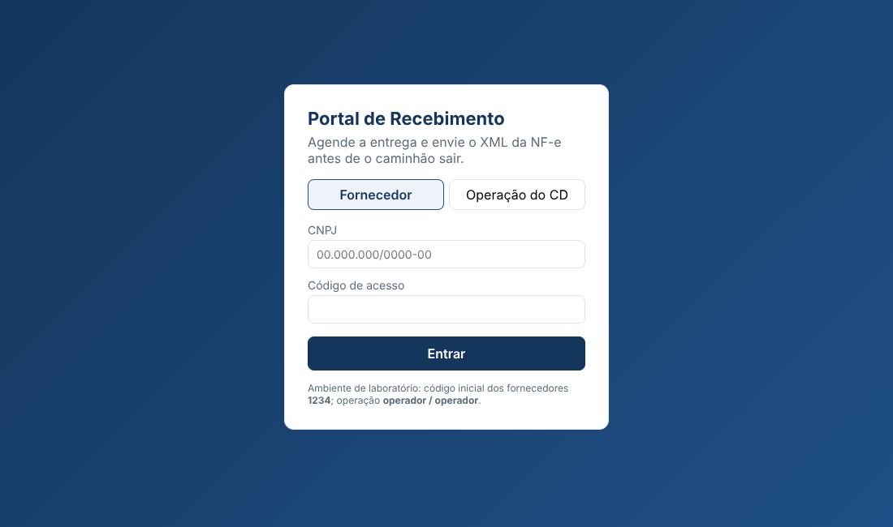
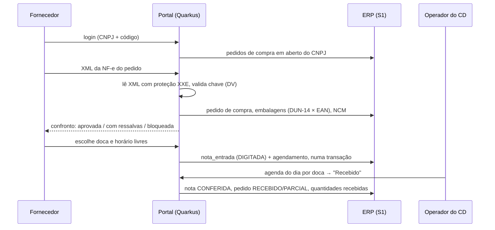

# S5 · Portal de agendamento de recebimento

Portal web (Quarkus + React) inspirado no Super Agenda: o **fornecedor agenda a doca e o horário** de descarga e **envia o XML da NF-e antes de o caminhão sair**. O portal confronta a nota com o **pedido de compra** do ERP (S1) e só libera o agendamento se não houver divergência grave. Na doca, o operador do CD marca o recebimento e o ERP é atualizado.

O problema que resolve é real em qualquer CD de supermercado: fila de caminhões sem hora marcada, nota com preço diferente do negociado descoberta com a mercadoria já no chão, caixa faturada como unidade, perecível esperando doca seca.



> Projeto de estudo com dados sintéticos. As NF-e de exemplo geradas pelo portal **não são documentos fiscais válidos** (sem assinatura digital).

## Fluxo



## Confronto pedido × NF-e

A comparação é sempre em **unidades** e **custo por unidade**: o fornecedor fatura em caixa (cEAN = DUN-14) ou em unidade (EAN-13), e o pedido guarda caixas com fator de conversão.

| Divergência | Efeito |
|---|---|
| Chave de acesso com DV inválido ou CNPJ da chave ≠ emitente | **bloqueia** |
| Modelo ≠ 55 / XML sem protocolo de autorização (cStat 100) | **bloqueia** |
| Emitente não é o fornecedor do pedido / destinatário não é a unidade do pedido | **bloqueia** |
| NF-e já apresentada em outro agendamento ou já no ERP | **bloqueia** |
| Produto não pedido | **bloqueia** |
| Quantidade acima do saldo do pedido | **bloqueia** |
| Custo unitário acima do negociado (tolerância de 0,5%), com o valor a mais na nota | **bloqueia** |
| Quantidade abaixo / item não faturado (entrega parcial) | ressalva |
| NCM diferente do cadastro (revisar tributação antes de escriturar) | ressalva |
| CFOP 5xxx/6xxx incompatível com operação interna/interestadual | ressalva |
| Nota sem o número do pedido (xPed) | ressalva |

## Regras de agenda

- Janelas configuráveis (`portal.horarios`), antecedência mínima de 1 dia, sem domingos, até 30 dias à frente.
- **Pedido com perecível só em doca refrigerada** (cadeia de frio); o CD tem 6 docas (2 refrigeradas), cada loja 2 (1 refrigerada).
- Conflito de horário resolvido pelo banco com **índice único parcial**: dois fornecedores clicando no mesmo horário, só um grava; o outro recebe 409.
- Um agendamento ativo por pedido e por chave de NF-e.
- Cancelamento pelo fornecedor libera o horário e recusa a nota digitada; "não compareceu" registrado pelo operador.

## Segurança

- XML de fornecedor é entrada não confiável: o parser **bloqueia DOCTYPE e entidades externas** (XXE), testado.
- Fornecedor só vê os próprios pedidos (pedido de outro CNPJ responde 404, sem revelar que existe).
- Usuário de banco `portal_s5`: lê pedidos de compra e cadastro, grava nota de entrada; **não** mexe em estoque nem vê clientes. A entrada no estoque é feita pelo ERP ao escriturar a nota conferida.
- Sessões com expiração; papéis FORNECEDOR e OPERADOR. Em produção, trocar por OIDC.

## Como rodar

Pré-requisitos: Java 21, Maven 3.9, Node 20+ e o S1 carregado.

```bash
cd frontend && npm ci && npm run build && cd ..    # gera a tela dentro de src/main/resources/META-INF/resources
mvn quarkus:dev                                    # http://localhost:8090
```

Para desenvolver a tela com recarga automática: `mvn quarkus:dev` num terminal e `npm run dev` em `frontend/` (http://localhost:5173, com proxy para a API).

Acesso de laboratório: qualquer fornecedor com pedido em aberto, código **1234** (descubra um CNPJ com `select t.cpf_cnpj from erp.pedido_compra pc join erp.transacionador t on t.id = pc.fornecedor_id limit 1;`); operação do CD: **operador / operador**. Na tela do pedido há o botão "Gerar NF-e de exemplo" com cenários (correta, entrega parcial, preço acima, produto não pedido, NCM divergente, outro destinatário, sem protocolo).

API: `POST /api/sessao`, `GET /api/pedidos`, `GET /api/pedidos/{id}`, `GET /api/pedidos/{id}/nfe-exemplo?cenario=`, `POST /api/pedidos/{id}/validar` (corpo XML), `GET /api/pedidos/{id}/disponibilidade?data=`, `POST /api/agendamentos`, `GET|DELETE /api/agendamentos`, `GET /api/operacao/agenda`, `POST /api/operacao/agendamentos/{id}/recebido`. Swagger em `/q/swagger-ui`.

## Testes

`mvn verify` (o CI carrega o S1 e roda tudo):

| Teste | Verifica |
|---|---|
| `LeitorNFeTest` | leitura do nfeProc, DV da chave, nota sem protocolo, **bloqueio de XXE**, XML que não é NF-e |
| `ConfrontoTest` | conversão caixa → unidade e todos os cenários de divergência |
| `PortalFluxoTest` | ponta a ponta contra o PostgreSQL: login, validação, disponibilidade, agendamento, conflito 409, nota DIGITADA no ERP, operador recebe, nota CONFERIDA e pedido RECEBIDO; nota com preço acima não agenda; acessos negados |

## Estrutura

```
nfe/          LeitorNFe (XML seguro), ChaveAcesso (DV mód. 11), GeradorNFeExemplo
dominio/      PedidoCompra, Confronto, Divergencia, ResultadoConfronto
banco/        Erp (leituras no S1), Agenda (schema portal: docas, agendamentos, acessos)
api/          PortalResource, Sessoes, mapeamento de erros
frontend/     React + Vite: login, pedidos, confronto, grade de horários, agenda do operador
```
